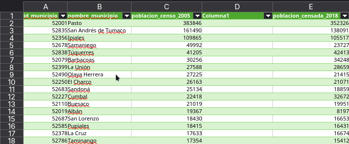
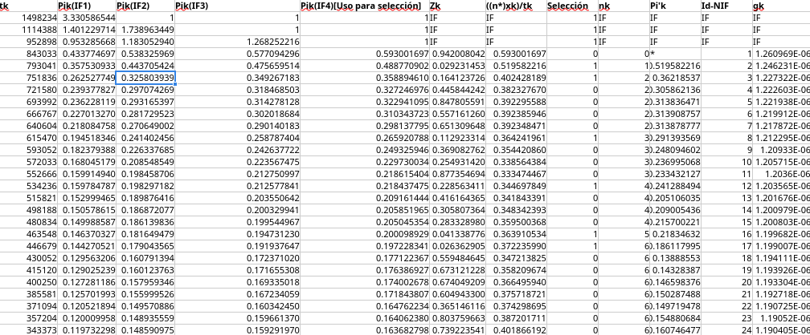
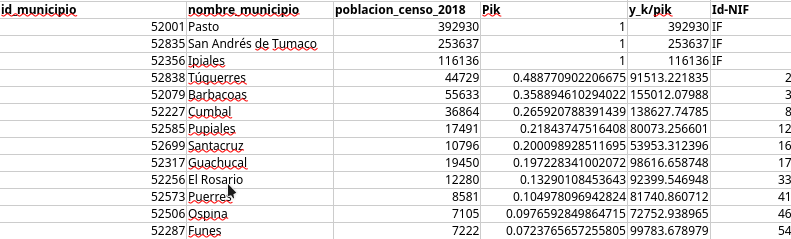
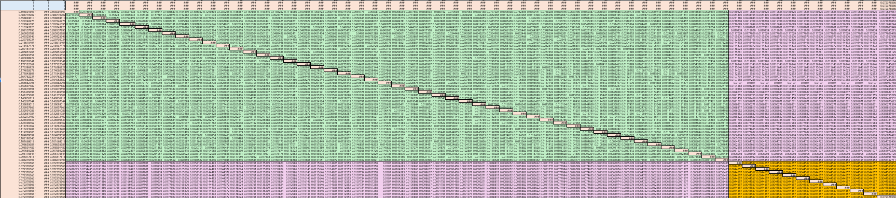
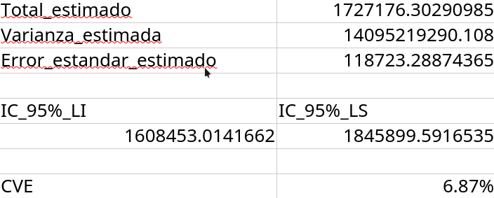

# Muestreos PPT - UNAL 2026-2

## Integrantes:

### Sergio Alejandro Buitrago Melo

### Camilo Andres Murcia Perdomo

# Introducción:

Este documento tiene como objetivo desarrollar 3 métodos de muestreo PPT (Sunter, Rao-Hartley-Cochran (RHC) y método acumulativo total (MAT)), los datos utilizados son los microdatos del DANE correspondientes a los censos del 2005 y 2018, filtrados en base a nuestras variables de interés y al departamento asignado de Nariño.

Los datos sin modificaciones se pueden encontrar en los portales oficiales del DANE y los datos filtrados que se usarán en este documento se pueden descargar directamente en este <a href="narino_poblacion_censo_2005_2018.csv" download>link</a>. De igual manera, de ser necesario se podrá consultar el código fuente de este proyecto en el repositorio correspondiente.

# Método 1: Sunter

Como primer método se realizará el algoritmo de Sunter; para este método se eligió el formato .xlsx, puesto que este permite mayor facilidad al momento de mostrar gráficamente la matriz de probabilidades de inclusión de segundo orden creada. Sin código que explicar, se realizará un resumen del método repasando al mismo tiempo cómo se construyó el documento.

El archivo .xlsx donde se realizó este método de muestreo se puede descargar directamente en el siguiente link -\-> <a href="Método Sunter.xlxs" download>Método Sunter.xlxs</a>, todo el procedimiento es igualmente explicado en este documento.

El archivo se divide en 2 páginas: la primera es la base de datos de poblaciones de Nariño sin filtrar:

### Página #1



Las variables a utilizar serán las poblaciones del censo 2005 y 2018.

### Página #2

La segunda página del .xlsx es la realización de la metodología, dividida de la siguiente manera:



Una tabla principal donde se desarrolla el método paso a paso, calculando los $\pi_k$ de manera reiterada para cada selección de los individuos de inclusión forzosa y los correspondientes para las siguientes 2 "etapas" del método de Sunter.



Una segunda tabla con la muestra final obtenida, con su respectiva $y_k$ y $y_k/\pi_k$.



La matriz calculada de los $\pi_{kl}$ usando 5 distintos colores correspondientes a las 5 distintas fórmulas generales del método y la suma correspondiente de los valores de la diagonal. (Esta matriz se aprecia de mejor manera en el archivo .xlsx descargable <a href="Método Sunter.xlxs" download>acá</a>)



Finalmente, tenemos casillas donde se ubicaron los valores finales de las estimaciones y un intervalo de confianza al 95%.

# Método 2: Rao-Hartley-Cochran (RHC)

El archivo .r donde se realizó este método de muestreo se puede descargar directamente en el siguiente link -\> <a href="RHC.r" download>RHC.r</a>, todo el código es igualmente explicado en este documento.

Para el segundo método tomaremos, de nuevo, una muestra de 12 individuos basada en nuestro dataframe.

```{r}
library(dplyr)
set.seed(5) #seed para reproducibilidad, se elige el número 5 para manifestar esa nota

poblacion <- read.csv("narino_poblacion_censo_2005_2018.csv")
poblacion$id_municipio<- 1:length(poblacion$nombre_municipio) 
head(poblacion[, c("id_municipio", "nombre_municipio", "poblacion_censo_2005")]) 

n_muestra <- 12
```

(Preliminares del archivo, se establecen las variables que vamos a usar y se fija el n)

Se crea un vector de índices; con estos índices se establecerán grupos aleatorios de tamaño similar:

```{r}
indices <- sample(1:length(poblacion$id_municipio))  

grupos <- split(indices, cut(seq_along(indices), breaks = n_muestra, labels = FALSE))

```

Dentro de cada uno de estos 12 grupos se va a elegir un solo individuo aleatoriamente basado en su tamaño, así, eligiendo una muestra de 12.

```{r}

seleccionados <- numeric(n_muestra) 


for (i in 1:n_muestra) {
  grupo_actual <- grupos[[i]]
  tamanos_grupo <- poblacion$poblacion_censo_2005[grupo_actual]
  prob <- tamanos_grupo / sum(tamanos_grupo)
  seleccionados[i] <- sample(grupo_actual, size = 1, prob = prob)
}

 seleccionados

muestra_final <- poblacion %>%
  filter(id_municipio %in% seleccionados) 

```

Es así como obtenemos nuestra muestra final del método RHC

```{r}
muestra_final<- muestra_final %>%
  select(id_municipio, nombre_municipio, poblacion_censo_2005, poblacion_censo_2018) 
 muestra_final

```

Con nuestra muestra podemos seguir las fórmulas de los estimadores de total y de varianza de esta forma:

```{r}

m <- n_muestra

X_grupo <- sapply(grupos, function(g) sum(poblacion$poblacion_censo_2005[g]))
x_sel   <- poblacion$poblacion_censo_2005[seleccionados]
y_sel   <- poblacion$poblacion_censo_2018[seleccionados]
Z       <- y_sel / (x_sel / X_grupo)   # y_i / p_i

total_estimado     <- sum(Z)
varianza_estimada  <- (m / (m - 1)) * sum((Z - mean(Z))^2)
error_estandar     <- sqrt(varianza_estimada)
cve                <- (error_estandar / total_estimado) * 100   
                 
```

Es así que verificamos nuestros resultados:

```{r}

total_estimado
varianza_estimada
error_estandar
cve

sum(poblacion$poblacion_censo_2018)  

```

Donde `sum(...)` nos indica el valor real publicado por el DANE.

O comparado con el $IC$:

```{r}
IC_95 <- total_estimado + c(-1, 1) * 1.96 * error_estandar
IC_95  
```

# Método 3: Método acumulativo total (MAT)

El archivo .r donde se realizó este método de muestreo se puede descargar directamente en el siguiente link -\> <a href="MAT.r" download>MAT.r</a>, todo el código es igualmente explicado en este documento.

El método acumulativo total será nuestro último método para hallar una muestra de tamaño 12; sin embargo, los preliminares de este método en R son parecidos al método anterior:

```{r}

datos <- read.csv("narino_poblacion_censo_2005_2018.csv")
set.seed(5)


n <- 12
```

(se usa `n <- 12` al igual que en RHC, pues será el tamaño de la muestra)

```{r}
tamano <- datos$poblacion_censo_2005
intervalo <- sum(tamano) / n
arranque <- runif(1, min = 0, max = intervalo)
puntos <- arranque + (0:(n - 1)) * intervalo
seleccion <- findInterval(puntos, c(0, cumsum(tamano)), rightmost.closed = TRUE)

```

Se crearon objetos `tamano`, `intervalo`, `arranque`, `puntos` y `seleccion` para usar la función `findInterval`, la cual determinará nuestra selección, tal que:

```{r}
muestra <- datos[seleccion, , drop = FALSE]
muestra<- muestra[,c("id_municipio", "nombre_municipio", "poblacion_censo_2005", "poblacion_censo_2018")]
muestra

```

Obteniendo así nuestra muestra, con la cual calcularemos los estimados de total y varianza:

```{r}

X_total <- sum(datos$poblacion_censo_2005)
x_sel   <- datos$poblacion_censo_2005[seleccion]
y_sel   <- datos$poblacion_censo_2018[seleccion]
Z       <- y_sel / (x_sel / X_total)   

total_estimado     <- mean(Z)          
varianza_estimada  <- var(Z) / n       
error_estandar     <- sqrt(varianza_estimada)
cve                <- (error_estandar / total_estimado) * 100

```

Así, conseguimos nuestras estimaciones:

```{r}

total_estimado
varianza_estimada
error_estandar
cve
```

Comparado con nuestro total real:

```{r}

sum(datos$poblacion_censo_2018)
```

O con el $IC$:

```{r}
IC_95 <- total_estimado + c(-1, 1) * 1.96 * error_estandar
IC_95

```

# Conclusiones y cierre:

Tras elegir y evaluar las muestras se encontró que: en cualquiera de las metodologías usadas, nuestros intervalos de confianza al 95% cumplieron al tener el total real del censo de Nariño dentro. De igual manera, se puede verificar las diferencias entre los CVE de cada método, siendo el método de Sunter el más complejo pero retornando a cambio un coeficiente notablemente más bajo que los otros.

Se exploraron 3 alternativas, cada una con sus peculiaridades y muestras obtenidas distintas; al tiempo, estas se desarrollaron en 2 herramientas de análisis y visualización de datos como lo es R (y sus respectivos IDE) y Excel (o equivalentes), dando así una visión más general y práctica de los algoritmos de selección estudiados, aportando a la comprensión de los temas de manera didáctica y aplicada a datos reales.