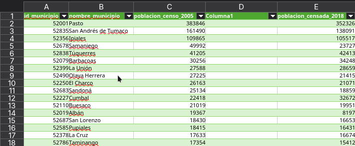
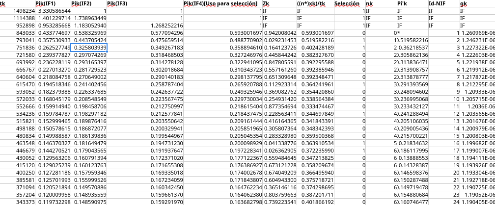

# Muestreos PPT - UNAL 2026-2

## Integrantes:

### Sergio Alejandro Buitrago Melo

### Camilo Andres Murcia Perdomo

# Introduccion:

Este documento tiene como objetivo desarrollar 3 métodos de muestreo PPT, los datos utilizados son los microdatos del DANE correspondientes a los censos del 2005 y 2018, filtrados en base a nuestras variables de interes y al departamento asignado de Nariño.

Los datos en sin modificaciones se pueden encontrar en los portales oficiales del DANE y los datos fltrados que se usarán en este documento se pueden descargar directamente en este <a href="narino_poblacion_censo_2005_2018.csv" download>link</a>. De igual manera, de ser necesario se podra consultar el codigo fuente de este proyecto en el repositorio correspondiente.

# Metodo 1: Sunder

Como primer método se realizará el algoritmo de sunter, para este método se eligió el formato .xlxs puesto que este permite mayor facilidad al momento de mostrar gráficamente la matriz de probabilidades de inclusion de segundo orden creada. Sin código que explicar, se realizara un resumen del método repasando al mismo tiempo como se construyó el documento.

El archivo .xlxs donde se realizó este método de muestreo se puede descargar directamente en el siguiente link -\> <a href="Método Sunter.xlxs" download>Método Sunter.xlxs</a>, todo el procedimiento es igualmente explicado en este documento.

El archivo se divide en 2 secciones, la primera siendo la base de datos de poblaciones de nariño sin filtrar:



Las variables a utilizar serán las poblaciones del censo 2005 y 2018.

La segunda Página del .xlxs es la realizacion de la metodologia, dividida de la siguiente manera:



# Metodo 2: Rao-Hartley-Cochran (RHC)

El archivo .r donde se realizó este método de muestreo se puede descargar directamente en el siguiente link -\> <a href="RHC.r" download>RHC.r</a>, todo el código es igualmente explicado en este documento.

Para el segundo método tomaremos, de nuevo, una muestra de 12 individuos basado en nuestro dataframe.

```{r}
library(dplyr)
set.seed(5) #seed para reproducibilidad, se elige el número 5 para manifestar esa nota

poblacion <- read.csv("narino_poblacion_censo_2005_2018.csv")
poblacion$id_municipio<- 1:length(poblacion$nombre_municipio) 
head(poblacion[, c("id_municipio", "nombre_municipio", "poblacion_censo_2005")]) 

n_muestra <- 12
```

(Preliminares del archivo, se establecen las variables que vamos a usar y se fija el n)

Se crea un vector de indices, con estos indices se establecran grupos aleatorios de tamaño similar:

```{r}
indices <- sample(1:length(poblacion$id_municipio))  

grupos <- split(indices, cut(seq_along(indices), breaks = n_muestra, labels = FALSE))

```

Dentro de cada uno de estos 12 grupos se va a elegir un solo individuo aleatoriamente basado en su tamaño, así, eligiendo una muestra de 12.

```{r}

seleccionados <- numeric(n_muestra) 


for (i in 1:n_muestra) {
  grupo_actual <- grupos[[i]]
  tamanos_grupo <- poblacion$poblacion_censo_2005[grupo_actual]
  prob <- tamanos_grupo / sum(tamanos_grupo)
  seleccionados[i] <- sample(grupo_actual, size = 1, prob = prob)
}

 seleccionados

muestra_final <- poblacion %>%
  filter(id_municipio %in% seleccionados) 

```

Es asì como obtenemos nuestra muestra final del método RHC

```{r}
muestra_final<- muestra_final %>%
  select(id_municipio, nombre_municipio, poblacion_censo_2005, poblacion_censo_2018) 
 muestra_final

```

Con nuestra muestra podemos seguir la formulas de los estimadores de total y de varianza de esta forma:

```{r}

m <- n_muestra

X_grupo <- sapply(grupos, function(g) sum(poblacion$poblacion_censo_2005[g]))
x_sel   <- poblacion$poblacion_censo_2005[seleccionados]
y_sel   <- poblacion$poblacion_censo_2018[seleccionados]
Z       <- y_sel / (x_sel / X_grupo)   # y_i / p_i

total_estimado     <- sum(Z)
varianza_estimada  <- (m / (m - 1)) * sum((Z - mean(Z))^2)
error_estandar     <- sqrt(varianza_estimada)
cve                <- (error_estandar / total_estimado) * 100   
                 
```

Es asì que verificamos nuestros resultados:

```{r}

total_estimado
varianza_estimada
error_estandar
cve

sum(poblacion$poblacion_censo_2018)  

```

Donde `sum(...)` nos indica el valor real publicado por el DANE

# Método 3: Metodo acumulativo Total (MAT)

El archivo .r donde se realizó este método de muestreo se puede descargar directamente en el siguiente link -\> <a href="MAT.r" download>MAT.r</a>, todo el código es igualmente explicado en este documento.

El método acumulativo total será nuestro último método para hallar una muestra de tamaño 12, sin embargo, los preliminares de este método en R son parecidos al metodo anterior:

```{r}

datos <- read.csv("narino_poblacion_censo_2005_2018.csv")
set.seed(5)


n <- 12
```

(se usa `n <- 12`al igual que en RHC pues será el tamaño de la muestra)

```{r}
tamano <- datos$poblacion_censo_2005
intervalo <- sum(tamano) / n
arranque <- runif(1, min = 0, max = intervalo)
puntos <- arranque + (0:(n - 1)) * intervalo
seleccion <- findInterval(puntos, c(0, cumsum(tamano)), rightmost.closed = TRUE)

```

Se crearon objetos `tamano intervalo arranque puntos` y `seleccion` para usar la funcion `findinterval` la cual determinara nuestra seleccion, tal que:

```{r}
muestra <- datos[seleccion, , drop = FALSE]
muestra<- muestra[,c("id_municipio", "nombre_municipio", "poblacion_censo_2005", "poblacion_censo_2018")]
muestra

```

Obteniendo asi nuestra muestra, con la cual calcularemos los estimados de total y varianza:

```{r}

X_total <- sum(datos$poblacion_censo_2005)
x_sel   <- datos$poblacion_censo_2005[seleccion]
y_sel   <- datos$poblacion_censo_2018[seleccion]
Z       <- y_sel / (x_sel / X_total)   # y_i / p_i

total_estimado     <- mean(Z)          # (1/n) * sum(Z)
varianza_estimada  <- var(Z) / n       # (1/(n(n-1))) * sum((Z - mean(Z))^2)
error_estandar     <- sqrt(varianza_estimada)
cve                <- (error_estandar / total_estimado) * 100

```

Así, conseguimos nuestras estimaciones:

```{r}

total_estimado
varianza_estimada
error_estandar
cve
```

Comparable con nuestro total real:

```{r}

sum(datos$poblacion_censo_2018)
```